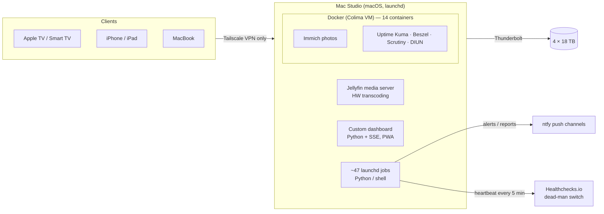

# Home Lab — a self-hosted 24/7 home server

A home server I designed, built and operate on my own: media streaming, family photo backup, monitoring,
alerts and remote access — running unattended around the clock on Apple Silicon with 72 TB of external storage.

This repository is a **curated public extract**. The full project (≈700 files: Python and shell services,
launchd jobs, Docker stacks, a web dashboard and 150+ test files) is private because it holds network details
and personal data. The scripts here are real production code from the server, lightly cleaned up.

## Hardware

| Part | Details |
|---|---|
| Host | Mac Studio, Apple M1 Max (10 cores), 32 GB RAM |
| Storage | OWC ThunderBay 4 over Thunderbolt — 4 × 18 TB enterprise HDDs, independent APFS volumes (media · photos · mirror · backups) |
| Measured throughput | ≈250–280 MB/s per drive, ≈1.06 GB/s with all four in parallel |
| History | Migrated twice (Mac Pro → iMac → Mac Studio), each time with a rehearsal run, a cut-over checklist and a rollback window |

## Architecture



## What runs on it

- **Media streaming** — Jellyfin with hardware transcoding (Apple VideoToolbox) for TVs, phones and laptops.
- **Photo backup** — Immich, fed by a nightly iCloud archive job and a drop-folder importer that verifies every file by SHA-1 before moving it.
- **Monitoring** — Uptime Kuma (service checks), Beszel (host metrics), Scrutiny (SMART history per drive), DIUN (container image updates), plus my own SMC sensor reader for CPU/GPU temperatures, fan speeds and DC input power.
- **Alerting** — four push channels (alerts / requests / media / reports). An alert names the problem and the action to take, and a matching "resolved" message is sent when it clears. A daily morning report covers everything else.
- **Remote access** — Tailscale only. No router port-forwards and nothing exposed to the public internet (the ISP is CGNAT anyway); SSH is key-only and the application firewall is on.

## Reliability engineering

The part I care about most is that the server keeps working without me watching it.

- **Boot ordering** — services that need the external drives start through [`wait-for-drives.sh`](scripts/wait-for-drives.sh), which waits on the kernel mount table. Before it existed, a reboot started services before the Thunderbolt volumes mounted and left them broken.
- **Self-healing VPN** — [`tailscale-selfcheck.sh`](scripts/tailscale-selfcheck.sh) runs every 5 minutes. If the server drops off the VPN for 10 minutes it reconnects by itself, and it raises an alert only if that fails. This was written after a 12-hour outage where every local check stayed green.
- **Hardware sensors without root** — [`host_sensors.py`](scripts/host_sensors.py) talks to the AppleSMC through IOKit (`ctypes`). It reads per-core temperatures, GPU and SSD temperatures, fan RPM and the 12 V rail's power in watts, plus macOS thermal-pressure level. I mapped the SMC keys on this machine by loading individual cores and watching which sensors moved.
- **Config drift detection** — [`drift-check.sh`](scripts/drift-check.sh) compares every script, launchd plist and compose file in git with the deployed copy, byte for byte. Deploys keep a dated rollback copy.
- **Backups** — weekly hard-linked snapshots, each followed by a verify and an integrity step. Old snapshots are pruned only after all three steps pass. A daily SHA-256-verified mirror of the newest snapshot goes to a second drive, and restore tests are part of the routine. Container databases are copied consistently, never opened live.
- **Scheduled reboots with proof** — a planned night-time reboot waits for a quiet moment and records a "fingerprint" of the system first: volumes, daemons, containers, ports, HTTP answers and VPN state. After boot it compares the fingerprint again and reports either "came back whole" or exactly what didn't.
- **Readiness checks** — a single command reports PASS/WARN/FAIL across storage, services, ports, VPN and backups. It must show 0 FAIL after every change.

## Repository contents

```
scripts/
  host_sensors.py         AppleSMC + thermal pressure via IOKit/ctypes → one JSON line
  wait-for-drives.sh      launchd wrapper: start a service only after its volumes mount
  tailscale-selfcheck.sh  VPN watchdog with grace period, auto-reconnect and alerting
  drift-check.sh          git ↔ deployed files, byte-for-byte
tests/                    unittest suites (fake `mount`, fake `tailscale`/`scutil`, fake SMC)
```

Run the tests:

```bash
python3 -m unittest discover -s tests -v
```

The `host_sensors` tests need macOS on Apple Silicon. The shell-script tests run anywhere with bash.
`tailscale-selfcheck.sh` calls a small notification helper (`ntfy-incident.sh`) that isn't included here. The tests replace it with a stub.

## Skills involved

macOS internals (launchd, IOKit, TCC privacy permissions), Linux VMs and Docker, networking and VPN, storage and backup design,
Python and Bash, writing tests for system scripts, and keeping everything documented: architecture, state, decisions and changelog.
